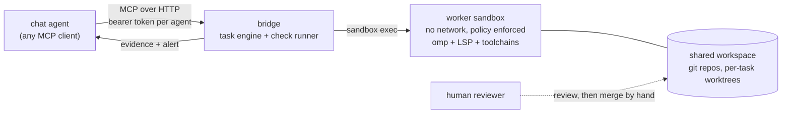

# sandboxed-delegation

A reference implementation of one idea: **a chat agent that needs a code change should delegate it, over a narrow tool interface, to a
coding worker that lives in a policy-enforced sandbox, and a human should review and merge the result.** The agent never gets a shell
on a machine. It gets eleven MCP tools, and everything else happens inside the sandbox under rules the operator wrote.

It is built and tested on one stack: [Hermes Agent](https://github.com/NousResearch/hermes-agent) as the chat agent,
[OpenShell](https://github.com/NVIDIA/OpenShell) v0.1.2 (rootless Podman) as the sandbox runtime, and
[omp](https://github.com/can1357/oh-my-pi) 18.9.2 as the coding worker. The design is written so you can adapt it to other pieces;
the code is not generalized beyond that stack, and no other stack has been tried.

> **Status: a working reference implementation, not a product.** It was proven on a single self-hosted setup (see
> [what was observed](#what-was-observed-and-what-was-not)). There are no releases and no stability promises. Read the
> [trust model](docs/trust-model.md) before you point anything real at it.



## What the bridge does

- **Tools, not a shell.** `submit_task`, `send_feedback`, `task_status`, `task_result`, `cancel_task`, `close_task`, `list_tasks`,
  `list_models`, `set_default_model`, `create_project`, `list_projects`. Each agent authenticates with its own token and sees only its
  own tasks.
- **One locked git worktree per task**, on its own branch. The bridge never merges anything.
- **The bridge runs the checks, not the worker.** The agent supplies `done_criteria` as literal command arrays; the bridge runs them
  after each round. The worker's own claim that it is done is advisory.
- **Git identity is decided and verified by the bridge**, per task, from where the work is going. See [docs/identity.md](docs/identity.md).
- **Alerts.** A waiter script wakes the delegating agent when a round ends, so it can end its turn instead of polling.
- **Evidence.** Every round leaves a spec, round log, check results and identity record for the human reviewer.
- **A model allowlist.** Agents choose among aliases the operator defined; they can never name a model id, URL or credential.

## Try it without any sandbox runtime

The quickstart runs the real bridge against a *fake* sandbox CLI and a *fake* omp, with real git worktrees, and walks an "agent"
through the whole loop over MCP. It needs only Python 3.13+ and git.

```bash
git clone https://github.com/sambegui/sandboxed-delegation.git
cd sandboxed-delegation
python3 examples/quickstart.py          # the loop end to end
cd tests && python3 -m unittest discover .   # the unit suite
```

This shows the contract and the evidence. It proves nothing about a real model or a real sandbox.

## Layout

| Path | What it is |
|---|---|
| `bridge/` | The service: MCP server, task engine, check runner, model allowlist. Python standard library only. |
| `tests/` | Unit suite against a fake sandbox CLI and a fake omp. |
| `examples/` | Quickstart, example `bridge.toml`, systemd unit, waiter script, an agent-side skill, shared workspace rules. |
| `worker-image/` | The worker container image (Dockerfile, pinned toolchains) plus an example sandbox policy and provider profile. |
| `docs/` | [architecture](docs/architecture.md), [trust model](docs/trust-model.md), [identity](docs/identity.md), [why not SSH plus a harness](docs/why-not-ssh.md). |

## What was observed, and what was not

Observed on one live setup (2026-10), with identifiers removed:

- Several chat agents, each in its own sandbox, called the bridge over MCP; a worker sandbox with no network ran the coding rounds.
- An agent created a project, delegated a Rust task, and was woken by the alert in a real chat conversation. The bridge's checks passed,
  and the commit carried the expected identity.
- The worker's own log showed LSP calls (rust-analyzer diagnostics and hover) answering during that task.
- Models behind the allowlist included a self-hosted endpoint and a hosted provider; when the hosted provider's quota ran out, the
  provider's own error text reached the agent.
- The unit suite (90 tests) passes offline.

**Not measured:** any comparison with SSH-plus-a-harness or with any other approach; output quality across many tasks or models; cost
and latency; behavior under concurrent load; long-running reliability; anything on a stack other than the one named above.

## Dependencies and non-endorsement

This project uses, and is not affiliated with or endorsed by, the authors of [Hermes Agent](https://github.com/NousResearch/hermes-agent)
(Nous Research), [OpenShell](https://github.com/NVIDIA/OpenShell) (NVIDIA) or [omp](https://github.com/can1357/oh-my-pi). Names are used
only to say what it was tested with. Check each project's own license and docs.

## Security

See [SECURITY.md](SECURITY.md) to report a vulnerability, and [docs/trust-model.md](docs/trust-model.md) for what this design does
and does not defend against.

## License

Apache-2.0. See [LICENSE](LICENSE) and [NOTICE](NOTICE).
