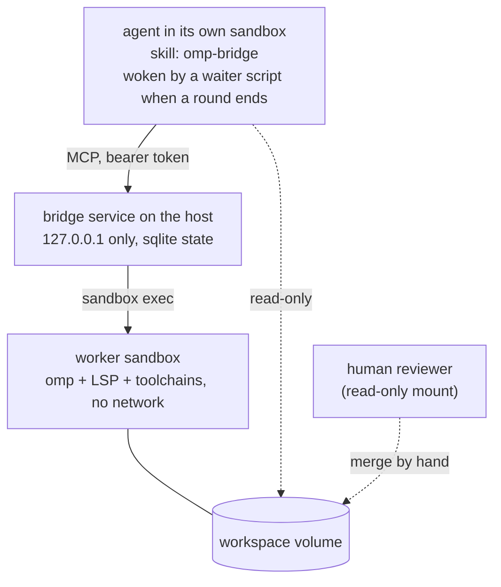

# Architecture

Evidence labels used in these docs: **OBSERVED** means seen on the live system the project was developed on; **VERIFIED** means proven by
a script or test in this repo; **INFERRED** is reasoning; **UNVERIFIED** has not been exercised.

## Parts

| Part | Role |
|---|---|
| **Bridge** (`bridge/`) | MCP server, task state machine, check runner, alerts. One process, Python standard library only, bound to loopback. |
| **Worker** (`worker-image/`) | One persistent sandbox running `omp`, with Rust, TypeScript and Python toolchains and language servers. No network. |
| **Workspace** | One labeled volume holding git repos, per-task worktrees and evidence. Mounted read-write in the worker, read-only in the agents' sandboxes. |
| **Agents** | Chat agents in their own sandboxes. They reach the bridge over MCP and nothing else about the worker. |
| **Human** | Reviews the branch read-only and merges. The bridge never merges. |

The bridge touches the workspace only through `sandbox exec` into the worker; its own host-side state is a sqlite database.

## The tools

`submit_task`, `send_feedback`, `task_status`, `task_result`, `cancel_task`, `close_task`, `list_tasks`, `list_models`,
`set_default_model`, `create_project`, `list_projects`. Authentication is per agent: the bridge stores only a sha256 digest of each
agent's bearer token and compares in constant time. An agent sees only its own tasks (VERIFIED, `tests/test_mcp.py`).

## One task, end to end

1. **Submit.** `submit_task(project, spec, done_criteria, ...)`. The bridge creates a locked git worktree
   `/sandbox/workspace/.worktrees/<project>/<task_id>` on branch `omp/<task_id>`, from the base branch. It never touches the project's
   main checkout.
2. **Round.** The worker runs `omp` (batch mode, or session mode through an in-sandbox daemon). The workspace `AGENTS.md` is passed to
   every round with `--append-system-prompt`, because omp reads `AGENTS.md` only from its working directory and every task runs in its
   own worktree.
3. **Claim.** The worker ends with a fenced `omp-bridge-status` block: `done`, `needs_info` or `blocked`. A missing or invalid block is
   `unclear`.
4. **Checks.** The bridge runs the agent's `done_criteria` in the worktree, plus a built-in `git identity` check. **The checks are the
   gate; the worker's claim is advisory.**
5. **Evidence and alert.** The bridge writes a spec, round logs, check results, `result.md` and an identity record under
   `/sandbox/workspace/.omp-bridge/<task_id>/` and wakes the waiting agent.
6. **Decide.** The agent closes the task or sends feedback for another round, up to `max_rounds`. A human reviews the branch and
   merges.

States: `queued`, `running`, `awaiting_review`, `needs_info`, `blocked`, `needs_human`, `failed`, then `closed` or `cancelled`. Every
change bumps a monotonic revision and wakes waiters. Hard stops (`max_rounds`, `round_max_time_s`, `total_wall_s`, `max_active_tasks`,
`spec_max_bytes`) end a task with a machine-readable reason. After a bridge restart, interrupted rounds are marked failed
(`service_restart`) and can be resumed by feedback.

## Alerts

The agent arms `examples/wait-task.sh`, which long-polls `GET /v1/wait/<task_id>`, and ends its turn; the completion notification
wakes it. OBSERVED live in a real chat conversation: the agent armed the waiter, ended its turn, and the completion woke it.

## Models

The operator defines aliases in `bridge.toml`; an agent can choose only an alias from `list_models`, never a model id, URL or credential
name. Provider credentials are sandbox-runtime providers attached to the worker, so the bridge never holds them. OBSERVED with a
self-hosted OpenAI-compatible endpoint and a hosted provider; when the hosted provider's quota ran out, the bridge reported the
provider's own error text in `runner_batch.provider_error`.

## Why session mode uses a daemon

A real `sandbox exec` does not stream: stdin arrives as one blob at EOF and no output returns until then (VERIFIED against omp 18.9.2).
An interactive rpc child therefore cannot be driven directly. One daemon per task (`bridge/assets/rpcd.sh`) runs `omp --mode rpc` on a
FIFO, the bridge sends frames with short execs and polls the output by byte offset, and a dead daemon is restarted with `--resume`.

## Reviewing and merging

The workspace is agent-written and therefore untrusted. A repository's `.git/config` and hooks would run as whoever uses git there. The
review pattern used in the live setup:

- Mount the workspace on the reviewer's machine, but treat it as read-only: use only read-only git, with `core.hooksPath=/dev/null`,
  `core.fsmonitor=` and an ownership exception scoped to the one repository.
- To publish a branch, fetch it into a **clean clone** (fresh config, empty hooks, no remote back to the workspace) and push from there.
- With squash merges, the workspace `main` goes stale (the squash commit is not a descendant of the branch). Rebase in the clean clone
  before the next pull request. Leave `remove_merged_worktrees` off, because a squash never makes the branch an ancestor of `main`.

## Known limits

- Worktrees prevent collisions, not malice: all tasks share one sandbox and one uid, and the worker can rewrite any repository's `.git`.
- Checks run inside the worker, so a worker that games its own environment can fool them. Human review is the real gate.
- Proofs judge infrastructure (a round starts, runs, ends, is checked, alerts, and leaves evidence), never model quality.
- UNVERIFIED: reassembly of oversized rpc frames from a real worker; which events besides the verified restart-with-resume kill the rpc
  daemon; behavior when a round is killed mid-write.
